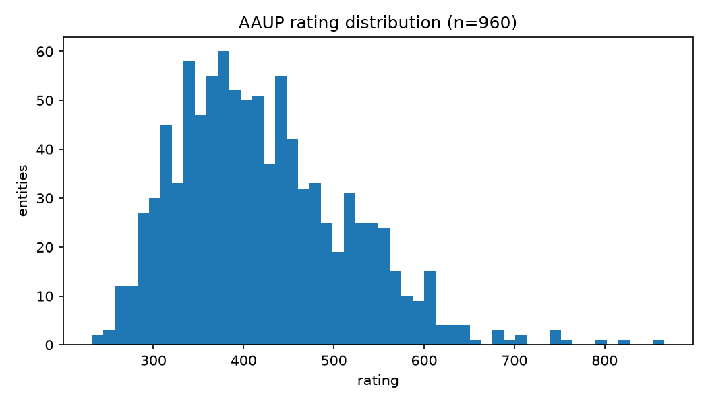
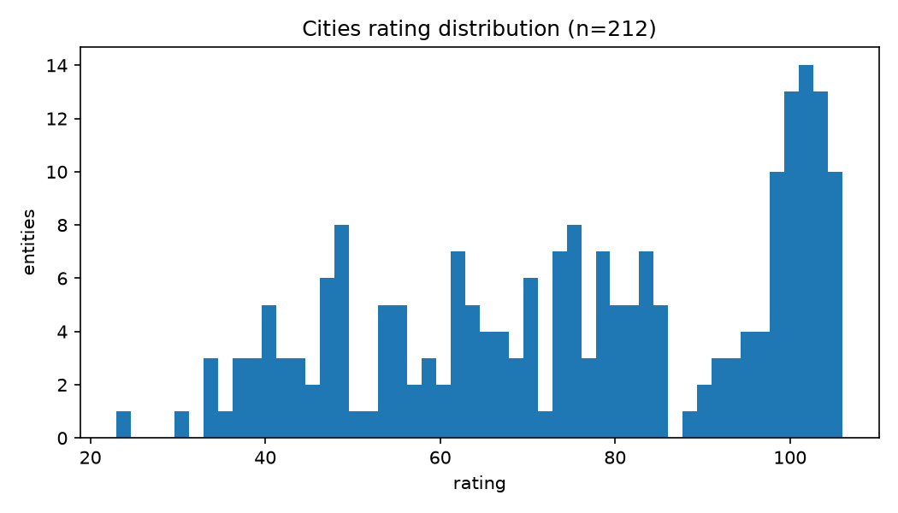
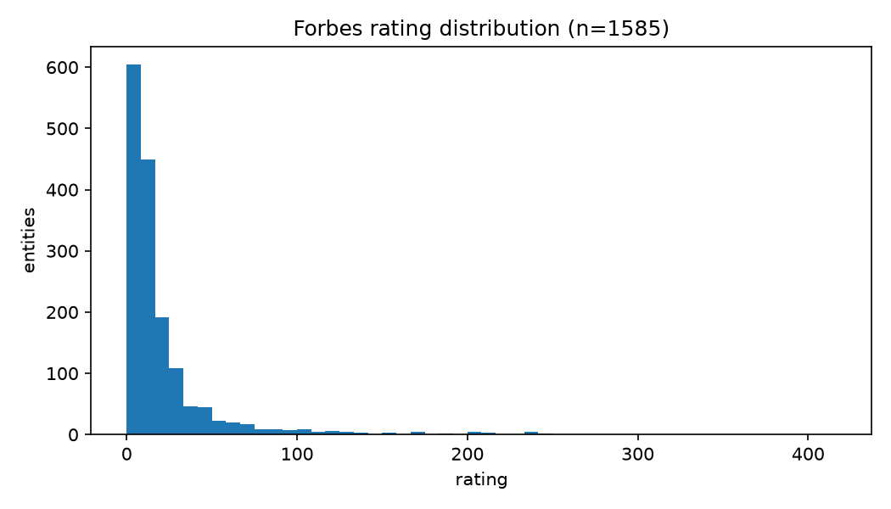
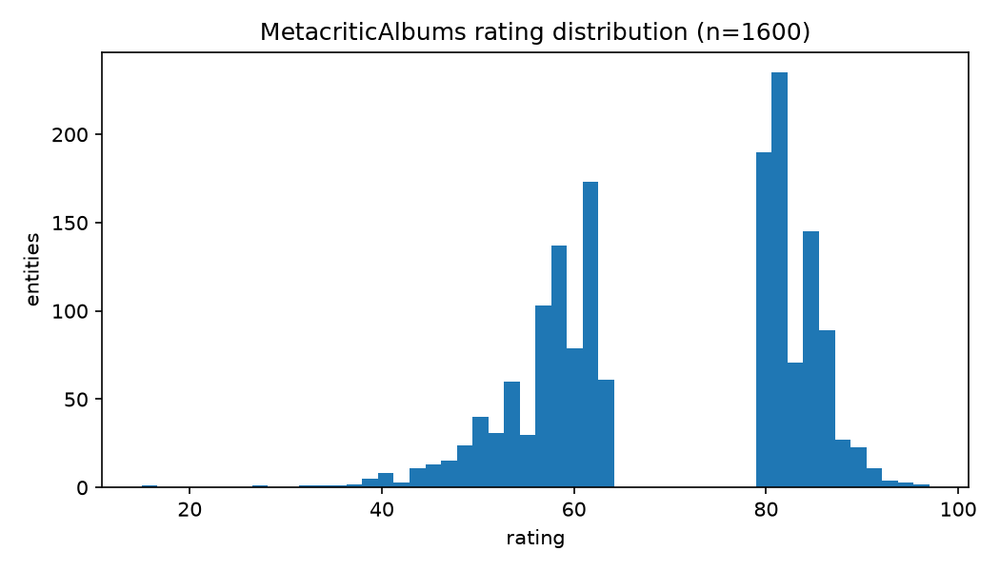
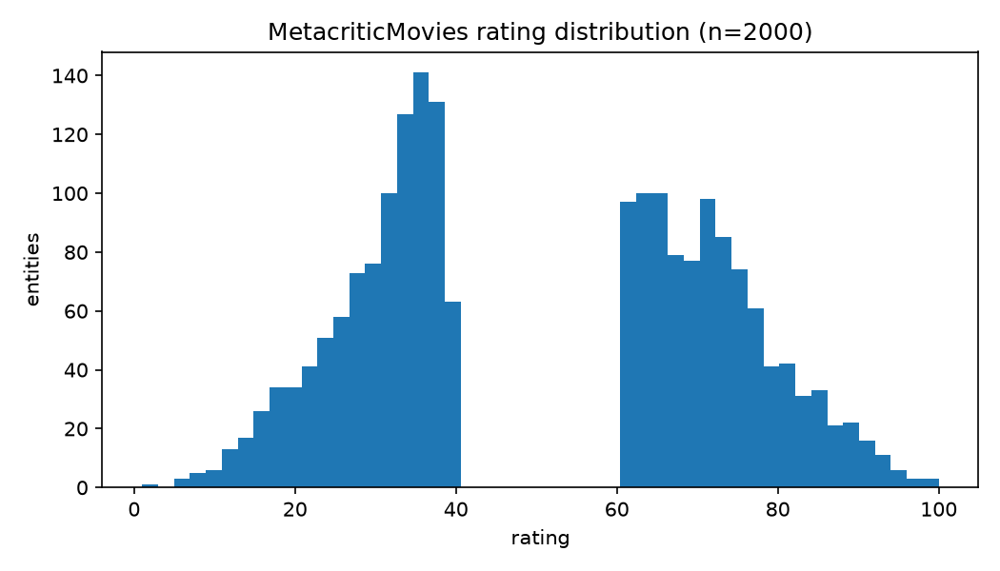

# GEval

GEval[^geval][^geval2] is an evaluation framework for node embedding
models. It abstracts away all the dataset, labels, querying, etc. stuff,
so in terms of implementations we don't have to care about where labels
come from - we just pass node->vector maps and get metrics back.

The datasets used are derived from a subset of English DBPedia (a dump
from 2016, ~12GB of data)

Supported tasks:

- Classification
- Regression
- Clustering
- Entity Relatedness
- Document Similarity
- Semantic Analogies

GeoRDF2Vec reports results only for classification, clustering and regression.

## How to run

Original GEval had a hard-requirement for python 3.6 or 3.7. These
versions are not supported anymore. That's why we have a fork as a
submodule, with patches which allow to run it with modern python.

I have tested only examples, you can do e.g something like this:

```sh
cd submodules/Evaluation-Framework
uv venv --python 3.8
uv pip install -e .
cd example
uv run python main_00.py
```

## Datasets

GEval datasets that are evaluated in GeoRDF2Vec paper:

- Classification: AAUP, Cities, Forbes, Albums, Movies
- Clustering: Cities and countries (2k); Cities and countries; Cities, albums, movies, AAUP, Forbes; Teams
- Regression: AAUP, Cities, Forbes, Albums, Movies

The GEval repo DOES NOT supply code for downloading or preparing datasets,
but GeoRDF2Vec does - so we use data downloading scripts from there.

The label files are taken from [^sw4ml] and are embedded in the repo
(e.g `evaluation_framework/Classification/data`). Embedding methods are
not supposed to see these labels - they operate on the KG only.

## Gotchas

- The benchmark penalizes insufficient coverage (that is, if vectors are
  missing for some entities)
- We have to emit the full entity urls as they are on dbpedia (not shortened
  ones or something), otherwise they will be ignored and this counts as
  unsufficient coverage = low score.
- Dataset leakage: some labels may duplicate what is already in the KG,
  which MIGHT be ok since we test embeddings which have to capture that
  information anyway?

## EDA summary

Data source: ~8.9M IRIs, ~2.5M literals, 85.6M relations of 678 types.
~6.57% of nodes have geographical location (a valid GeoRSS Point relation).

The datasets annotate a small subset of the source. Sometimes label rows
are duplicated - that's why we have more "labels" than "labeled entities"
and sometimes labels don't add up to labeled entity count.

### Classification

| Dataset          | Classes | Labels | Labeled entities | % of nodes |
| ---------------- | ------: | -----: | ---------------: | ---------: |
| AAUP             |       3 |    960 |              933 |  0.010492% |
| Cities           |       3 |    212 |              212 |  0.002384% |
| Forbes           |       3 |   1585 |             1585 |  0.017823% |
| MetacriticAlbums |       2 |   1600 |             1592 |  0.017902% |
| MetacriticMovies |       2 |   2000 |             2000 |  0.022490% |

Classes for classification datasets are the result of discretization
of the corresponding regression datasets. [^aaup-data] [^cities-data] [^forbes-data] [^albums-data] [^movies-data]

#### AAUP

| Class  | Labels | % of labels |
| ------ | -----: | ----------: |
| high   |    197 |    20.5208% |
| low    |    236 |    24.5833% |
| medium |    527 |    54.8958% |

#### Cities

| Class  | Labels | % of labels |
| ------ | -----: | ----------: |
| high   |     67 |    31.6038% |
| low    |     39 |    18.3962% |
| medium |    106 |    50.0000% |

#### Forbes

| Class  | Labels | % of labels |
| ------ | -----: | ----------: |
| high   |     66 |     4.1640% |
| low    |    738 |    46.5615% |
| medium |    781 |    49.2744% |

#### MetacriticAlbums

| Class | Labels | % of labels |
| ----- | -----: | ----------: |
| bad   |    800 |    50.0000% |
| good  |    800 |    50.0000% |

#### MetacriticMovies

| Class | Labels | % of labels |
| ----- | -----: | ----------: |
| bad   |   1000 |    50.0000% |
| good  |   1000 |    50.0000% |

### Regression

| Dataset          | Labeled entities | % of nodes |
| ---------------- | ---------------: | ---------: |
| AAUP             |              933 |  0.010492% |
| Cities           |              212 |  0.002384% |
| Forbes           |             1585 |  0.017823% |
| MetacriticAlbums |             1592 |  0.017902% |
| MetacriticMovies |             2000 |  0.022490% |







Especially interesting are the holes in metacritic rating distributions.
The original data sources[^metacritic_data] already have these holes,
it's possible that they have just excluded "medium" ratings for some
reason.

### Clustering

| Dataset                                | Clusters |
| -------------------------------------- | -------: |
| cities2000AndCountries_cluster         |        2 |
| citiesAndCountries_cluster             |        2 |
| citiesMoviesAlbumsCompaniesUni_cluster |        5 |
| teams_cluster                          |        2 |

## References

[^geval]: A Configurable Evaluation Framework for Node Embedding Techniques https://link.springer.com/chapter/10.1007/978-3-030-32327-1_31

[^geval2]: GEval: A Modular and Extensible Evaluation Framework for Graph Embedding Techniques https://pmc.ncbi.nlm.nih.gov/articles/PMC7250612/pdf/978-3-030-49461-2_Chapter_33.pdf

[^metacritic_data]: https://data.dws.informatik.uni-mannheim.de/rmlod/LOD_ML_Datasets/data/datasets/MetacriticAlbums/FinalDataset15.tsv

[^sw4ml]:
    Ristoski, P., de Vries, G. K. D., & Paulheim, H. (2016). A Collection of Benchmark Datasets for Systematic Evaluations of Machine Learning on the Semantic Web. In The Semantic Web – ISWC 2016, LNCS 9982, pp. 186–194.
    Springer. https://doi.org/10.1007/978-3-319-46547-0_20

[^aaup-data]:
    Data and Web Science Group, University of Mannheim. AAUP dataset description (readme.txt), SW4ML benchmark collection.
    https://data.dws.informatik.uni-mannheim.de/rmlod/LOD_ML_Datasets/data/datasets/DatasetsWithFeatures/AAUP/readme.txt (accessed 2026-10-31). Original data: AAUP Faculty Salary data, JSE Data Archive,
    https://jse.amstat.org/datasets/aaup.txt.

[^cities-data]:
    Data and Web Science Group, University of Mannheim. Cities dataset description (README.txt), SW4ML benchmark collection.
    https://data.dws.informatik.uni-mannheim.de/rmlod/LOD_ML_Datasets/data/datasets/CitiesQualityOfLiving/README.txt (accessed 2026-10-31). Original data: William M. Mercer, Worldwide Quality of Living Survey,
    http://across.co.nz/qualityofliving.htm.

[^forbes-data]:
    Data and Web Science Group, University of Mannheim. Forbes dataset description (readme.txt), SW4ML benchmark collection.
    https://data.dws.informatik.uni-mannheim.de/rmlod/LOD_ML_Datasets/data/datasets/DatasetsWithFeatures/Forbes2013/readme.txt (accessed 2026-10-31). Original data: Forbes Global 2000, http://www.forbes.com/global2000/list/.

[^albums-data]:
    Data and Web Science Group, University of Mannheim. Metacritic Albums dataset description (ReadMe.txt), SW4ML benchmark collection.
    https://data.dws.informatik.uni-mannheim.de/rmlod/LOD_ML_Datasets/data/datasets/MetacriticAlbums/ReadMe.txt (accessed 2026-10-31). Original data: Metacritic album metascore list,
    http://www.metacritic.com/browse/albums/score/metascore/all. See also Ristoski et al., The Linked Data Mining Challenge 2016, CEUR-WS Vol-1586, https://ceur-ws.org/Vol-1586/ldmc1.pdf.

[^movies-data]:
    Data and Web Science Group, University of Mannheim. Metacritic Movies dataset description (README.txt), SW4ML benchmark collection.
    https://data.dws.informatik.uni-mannheim.de/rmlod/LOD_ML_Datasets/data/datasets/MetacriticMovies/README.txt (accessed 2026-10-31). Original data: Metacritic movie metascore list,
    http://www.metacritic.com/browse/movies/score/metascore/all. See also Ristoski et al., The Linked Data Mining Challenge 2015, CEUR-WS Vol-1365, https://ceur-ws.org/Vol-1365/paper13.pdf.
